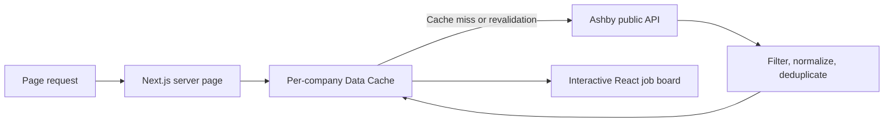

# TALYN

**A focused job board for people building AI applications, agents, and LLM products.**

TALYN brings published engineering openings from selected AI companies into a minimal, searchable interface. Listings come directly from employers' public Ashby job boards, with links to their original applications.

## Features

- **Live employer feeds** — server-side fetching from 11 configured companies.
- **Focused role filtering** — rules for AI, LLM, agent, and relevant application engineering roles.
- **Combined search and filters** — search roles, companies, and locations; select companies and fully remote openings together.
- **Useful listing details** — company identity, role, locations, publication age, and a direct application link.
- **Responsive browsing** — a horizontally scrollable table with accessible Apply actions on smaller screens.
- **Clear feedback** — matching job/company counts, removable filters, empty states, loading feedback, and stale-data notices.

## Tech stack

| Layer | Technology |
| --- | --- |
| Framework | Next.js 16.4.6, App Router |
| Interface | React 19.3.1 |
| Language | TypeScript |
| Styling | Tailwind CSS 4.3.5 and custom CSS |
| Job data | Ashby public Job Posting API |
| Caching | Next.js Data Cache with `unstable_cache` |
| Tests | Node.js built-in test runner |

## Getting started

### Requirements

- Node.js **24.x, version 24.22.1 or newer** within that release line.
- npm, included with Node.js.
- Network access to the public employer feeds.

No application API keys, environment variables, or database setup are required.

### Local development

```sh
git clone https://github.com/edwieee/talyn.git
cd talyn
npm ci
npm run dev
```

Open [http://127.0.0.1:3000](http://127.0.0.1:3000).

The first request can take longer while company feeds populate the cache. Both development and production preview commands bind to `127.0.0.1` by default.

On Windows PowerShell, use `npm.cmd` in place of `npm` if the shell blocks the npm PowerShell script.

### Project commands

| Command | Purpose |
| --- | --- |
| `npm run dev` | Start the local development server |
| `npm test` | Run the job-data and filtering tests |
| `npm run build` | Create the production build and run Next.js TypeScript validation |
| `npm run typecheck` | Run the standalone TypeScript check |
| `npm start` | Serve the production build locally |

For a production check:

```sh
npm test
npm run build
npm run typecheck
npm start
```

Run development or a build before the standalone type check on a fresh checkout so that Next.js can generate its type files.

## Architecture



The home page requests job data on the server. Each employer has an independently cached snapshot. On a cache miss, the fetcher requests the public board endpoint, validates and normalizes its response, and stores the resulting snapshot. Readers are processed in batches of four, with a 15-second timeout per provider request.

The combined results are sorted by publication time and passed to the client component. Search and company/remote filtering then run locally against that list. Apply links open the employer's application page in a new tab.

### Project structure

```text
src/
  app/
    page.tsx                 Server-rendered home page
    layout.tsx               Root layout and metadata
    globals.css              Theme, layout, and responsive styles
    loading.tsx              Loading state
    error.tsx                Error recovery
  components/
    job-board.tsx            Search, filters, results, and application links
    character-field.tsx      Decorative character background
  lib/
    feeds.ts                 Server-side provider requests and caching
    jobs.ts                  Company registry, normalization, and filtering
tests/
  jobs.test.ts               Data-processing and filtering tests
```

## Job sources and freshness

TALYN currently reads the [Ashby Job Posting API](https://developers.ashbyhq.com/docs/public-job-posting-api):

```text
GET https://api.ashbyhq.com/posting-api/job-board/{board}
```

Configured employers: **OpenAI, Perplexity, Cohere, LangChain, Harvey, ElevenLabs, Sierra, Writer, Replit, Baseten, and Cognition**. The company list and exact board identifiers live in `src/lib/jobs.ts`.

To add an employer, add its company ID, display name, verified Ashby board identifier, and domain to the `COMPANIES` array, then verify its public feed and resulting listings. Only Ashby-backed sources are implemented currently.

### Refresh behavior

- Each company snapshot has a **3,600-second revalidation threshold**.
- Revalidation is **triggered by page requests**, rather than by an hourly background schedule.
- An expired snapshot can be served while its replacement is fetched in the background. A later request receives the refreshed results.
- A failed initial feed is omitted. A failed refresh can retain the last successful snapshot; data older than 90 minutes receives a stale-data notice.
- The footer shows the oldest successful company fetch timestamp. It does not independently verify application availability.
- An already-open browser tab updates its listings on reload or navigation; client-side polling is not implemented.

### Data handling

Only jobs with `isListed === true` are considered. Titles and, for selected generic engineering titles, descriptions are checked against relevance rules. This is a heuristic: it can omit suitable jobs or include roles outside the intended focus.

The app retains summary fields and source/application URLs. Full descriptions are used during filtering but are not retained in the normalized listing records. There is no internal job-detail page, database, ingestion history, scheduled worker, or automatic company-discovery pipeline.

Remote Only requires `workplaceType === "Remote"`; hybrid roles and unspecified workplace types do not qualify. Publication dates come from the provider and represent its last publication time. Unknown dates remain unknown.

Closed or unlisted jobs disappear after a successful refreshed feed omits them. Application pages are not independently checked by the production app, so cached listings should be treated as the last known employer data.

## Testing

The test suite covers role classification, public visibility, feed validation, safe URLs, missing publication dates, deduplication, sorting, combined search and filters, remote/hybrid distinctions, partial provider failures, and stale snapshot handling.

Tests use synthetic records for deterministic checks; the application fetches its listings from live employer feeds. Test fixtures are not served as production listings.

## Deployment

### Vercel

1. Import the GitHub repository into Vercel.
2. Select the **Next.js** framework preset and **Node.js 24.x** runtime.
3. Use the default `npm run build` command. For this repository layout, use the repository root as the project root.
4. Deploy with the required outbound network access to Ashby.

The home page declares a **60-second function duration**. Use hosting that supports that budget and the required Next.js caching behavior. No application environment variables are currently required.

For another Node.js host, install dependencies with `npm ci`, run `npm run build`, and serve the build with `npm start`. Configure the bind address or a reverse proxy for the hosting environment; the included start script is intended for a local preview. Preserve an appropriate Data Cache if cached snapshots must survive server restarts.

## Repository hygiene

The `.gitignore` excludes environment files, local credentials, private key files, dependency folders, generated types, build output, deployment state, test output, and local editor files. `package-lock.json` is retained for reproducible installation. Any future `.env.example` should contain placeholders only.

## Design reference

The interface structure was inspired by [AI Design Jobs](https://ai-design-jobs.vercel.app/). TALYN's implementation is original, with a white theme, serif heading, locally generated character field, compact controls, and a table-based job list. Company icons use Google's favicon service with an initial-letter fallback.
